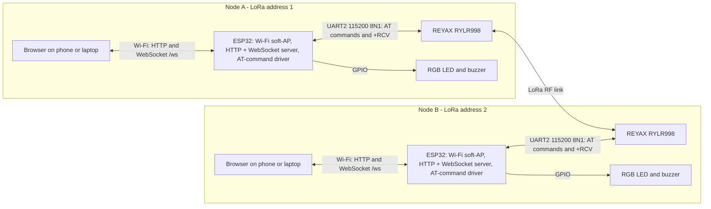
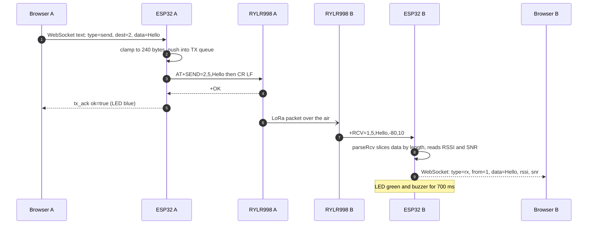
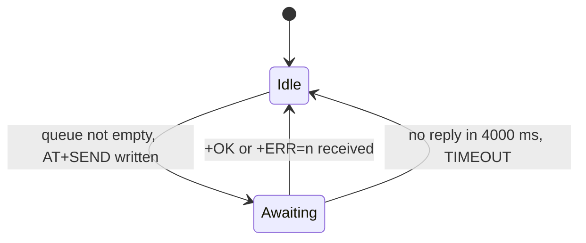
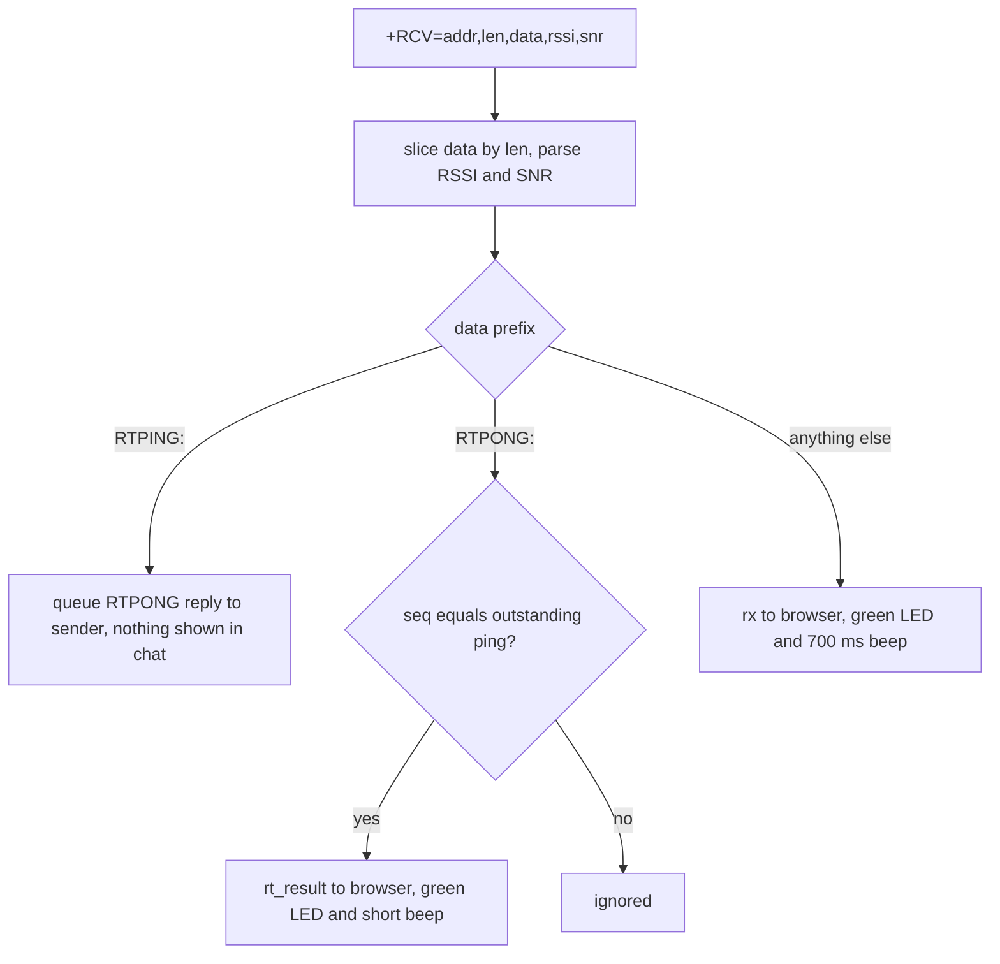
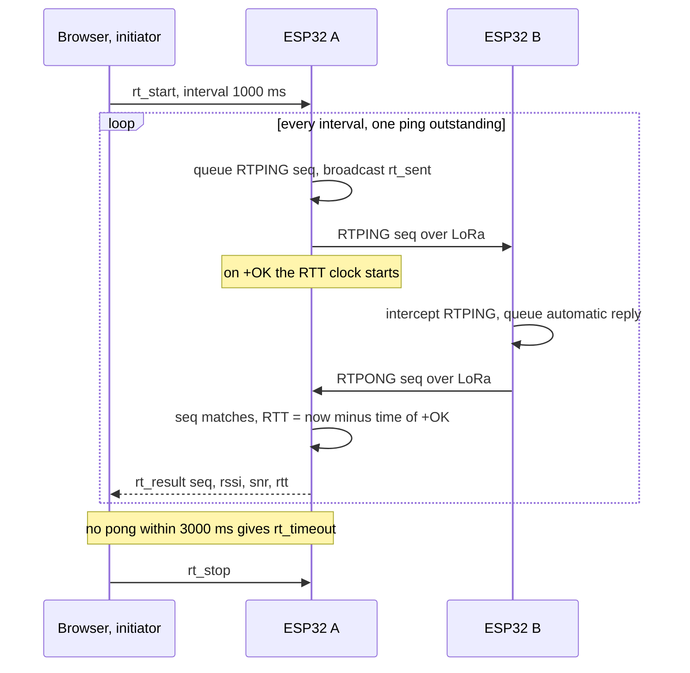

# Offline Messenger V1

**A two-node, infrastructure-independent text messenger built from an ESP32, a REYAX RYLR998 LoRa module, and a browser interface served over a local Wi-Fi access point.**

> The phone or laptop talks to its *own* ESP32 over Wi-Fi. The two ESP32 nodes talk to *each other* over LoRa. Wi-Fi is only the user interface; the long-range link is the sub-GHz LoRa radio.

---

## Contents

1. [Project overview](#1-project-overview)
2. [System architecture](#2-system-architecture)
3. [Hardware architecture and electronics](#3-hardware-architecture-and-electronics)
4. [LoRa communication architecture](#4-lora-communication-architecture)
5. [Network and communication model](#5-network-and-communication-model)
6. [Software architecture](#6-software-architecture)
7. [Message transmission and reception](#7-message-transmission-and-reception)
8. [Range testing and radio performance](#8-range-testing-and-radio-performance)
9. [Power system](#9-power-system)
10. [Installation and configuration](#10-installation-and-configuration)
11. [Testing and experimental observations](#11-testing-and-experimental-observations)
12. [Reliability, limitations, and security](#12-reliability-limitations-and-security)
13. [Future development](#13-future-development)
14. [Repository structure](#14-repository-structure)
15. [Engineering analysis](#15-engineering-analysis)
16. [Conclusion](#16-conclusion)
17. [References](#17-references)

---
## 1. Project overview

### 1.1 Definition and purpose

**Offline Messenger V1** is a pair of battery-capable radio nodes that exchange short ASCII text messages without the internet, cellular service, or any shared infrastructure. Each node consists of:

- an **ESP32** microcontroller that creates its own Wi-Fi access point and serves a web page,
- a **REYAX RYLR998** LoRa transceiver module, controlled over UART with AT commands,
- an **RGB LED and buzzer** for status feedback.

A user connects a phone or laptop to the node's Wi-Fi network, opens a browser page, and types messages into a terminal-style interface. The node forwards each message to the other node over LoRa.

### 1.2 Problem addressed

When cellular and internet connectivity are unavailable (remote terrain, disaster areas, events, or deliberate off-grid operation), ordinary messaging applications stop working. A sub-GHz LoRa link can carry small text payloads over kilometre-scale distances at low power, with no infrastructure other than the two endpoints.

### 1.3 Two different links

| | Local Wi-Fi link | LoRa radio link |
|---|---|---|
| Purpose | User interface only | Message transport between nodes |
| Endpoints | Browser ↔ its own ESP32 | ESP32 node A ↔ ESP32 node B (through the RYLR998 modules) |
| Medium | 2.4 GHz IEEE 802.11 (ESP32 soft-AP) | Sub-GHz ISM band (module default 915 MHz for RYLR998) |
| Typical reach | Tens of metres | Kilometres (see [Section 8](#8-range-testing-and-radio-performance)) |
| Protocols | HTTP, WebSocket | LoRa PHY with REYAX module framing (address, network ID) |
| Internet needed | No | No |

The two nodes never communicate over Wi-Fi. Each node hosts its own separate access point, and both access points use the same default address `192.168.4.1`. **[Confirmed]** (`WiFi.softAPIP()`; the address also appears in a supplied screenshot).

The "LINK UP / LINK DOWN" badge in the UI reports only whether the **browser's WebSocket to its own ESP32** is open. It says nothing about whether the other LoRa node is reachable. **[Confirmed]** (`ws.onopen` / `ws.onclose` in `script.js`).

### 1.4 Operating principle (without overclaiming)

The system implements **direct, addressed, point-to-point messaging** between two nodes. It does **not** implement LoRaWAN, mesh routing, multihop forwarding, application-layer acknowledgements, retransmission, or end-to-end encryption. See [Section 12](#12-reliability-limitations-and-security).

---

## 2. System architecture

### 2.1 Component roles

| Component | Role |
|---|---|
| **ESP32** | Wi-Fi soft-AP, HTTP/WebSocket server, UART driver for the LoRa module, TX queue, range-test scheduler, LED/buzzer control. |
| **REYAX RYLR998** | LoRa modem with an on-board Nuvoton MCU and Semtech LoRa engine. Exposes an AT-command interface over UART. Handles RF framing, addressing and network-ID filtering. |
| **Local Wi-Fi AP** | Provides a private IP network (default `192.168.4.1`) for the browser. |
| **Browser UI** | Single-page terminal: message log, input line, range-test panel. Plain HTML/CSS/JavaScript, no external dependencies. |
| **RGB LED + buzzer** | Local status feedback for receive, send success/failure, and range-test results. |
| **Power circuitry** | USB in the normal configuration; 18650 cell, charging module and boost converter in the battery configuration ([Section 9](#9-power-system)). |

### 2.2 Architecture diagram



Addresses 1 and 2 are the values in the supplied firmware (`MY_ADDRESS 1`, `DEST_ADDRESS 2`) and in a supplied screenshot of node 2 (`NODE 2`, `DEST 1`, `NET 18`). **[Confirmed]/[Observed]**. The addresses are compile-time constants and must be swapped on the second node.

### 2.3 Path of a message



The `+OK` returned to node A is an acknowledgement **from the local module**. It is not an acknowledgement from node B. **[Confirmed]** (no application-layer ACK exists in the firmware). When exactly the module emits `+OK` relative to the end of the RF transmission is **not specified** in the REYAX documents.

### 2.4 How the two nodes interact

- Both nodes run **identical firmware**; only `MY_ADDRESS`, `DEST_ADDRESS`, and the Wi-Fi SSID differ. **[Confirmed]**
- Chat messages are ordinary LoRa payloads addressed to the peer.
- Range-test packets are ordinary payloads that begin with `RTPING:` or `RTPONG:`. The firmware intercepts them before they reach the chat UI. The responder replies automatically, so no user needs to be present at the far node.

### 2.5 Confirmed versus inferred

| Statement | Basis |
|---|---|
| UART pins, queue size, timeouts, JSON message types, route list | **[Confirmed]** in source |
| Module AT syntax, default radio parameters, `+RCV` format, 240-byte limit, +8-byte overhead | **[Confirmed]** in REYAX AT guide |
| The `+OK` response arrives after the module has transmitted | **[Inferred]** (consistent with RTT of ~197 ms, see [Section 8.6](#86-airtime-and-the-observed-rtt)) |
| Cause of TX timeouts on non-PC power | **[Inferred]** (supply sag) |

---

## 3. Hardware architecture and electronics

### 3.1 Component table

| Component | Function | Details |
|---|---|---|
| ESP32 development board | Application processor, Wi-Fi AP, UART host | Exact board model: **Not documented**. Firmware uses the Arduino-ESP32 `Serial2` hardware UART. |
| REYAX RYLR998 | LoRa transceiver, AT-command interface | 868/915 MHz, VDD 2.3–3.6 V (3.3 V typical), RF output 0–22 dBm, UART default 115200 8N1, 5-pin header. Antenna variant (helical `RYLR998` or `RYLR998_M4` with I-PEX MHF4): **Not documented**. |
| RGB LED, **common anode** | Status indication | Common (longest) leg to 3V3; each colour leg through a resistor to a GPIO. Resistor values: **Not documented** (the design guidance was 220–330 Ω; roughly 150 Ω–1 kΩ is safe at 3.3 V). |
| Active buzzer | Audible indication | Driven directly from GPIO33 with plain HIGH/LOW. Rated current: **Not documented** (see D4). |
| 470 µF electrolytic capacitor | Bulk decoupling across module supply | Author-stated, **Requires verification** against schematic (D3). |
| 100 nF ceramic capacitor | High-frequency decoupling across module supply | Author-stated, **Requires verification**. |
| EN-to-GND capacitor (1–10 µF recommended) | Delays release of the ESP32 reset pin on power-up | Shown in the author's wiring diagram. Exact value: **Not documented**. Effect: see [Section 3.5](#35-cold-boot-behaviour). |
| 18650 Li-ion cell, charging module, MT3608 boost converter | Battery-powered configuration | Details in [Section 9](#9-power-system). |

### 3.2 UART interface and GPIO assignment

The firmware is the authority for pin numbers:

```cpp
#define LORA_RX_PIN 17   // ESP32 RX2  <- RYLR998 TXD
#define LORA_TX_PIN 16   // ESP32 TX2  -> RYLR998 RXD
#define LORA_BAUD   115200
LoRaSerial.begin(LORA_BAUD, SERIAL_8N1, LORA_RX_PIN, LORA_TX_PIN);
```

`Serial2.begin(baud, config, rxPin, txPin)` takes the **RX pin first**. The ESP32 **receives on GPIO17** and **transmits on GPIO16**. Note that this is the reverse of the Arduino-ESP32 default `Serial2` mapping (RX2 = 16, TX2 = 17). **[Confirmed]**

UART lines are always crossed: the ESP32's TX goes to the module's RXD, and the module's TXD goes to the ESP32's RX.

| Signal | ESP32 pin | RYLR998 pin | Direction |
|---|---|---|---|
| ESP32 TX (UART2) | GPIO16 | Pin 3, RXD | ESP32 → module |
| ESP32 RX (UART2) | GPIO17 | Pin 4, TXD | module → ESP32 |

Electrical compatibility: the module's digital input-high threshold is 0.8·VDD and its output swings to VDD, so a 3.3 V ESP32 and a 3.3 V-powered module are directly compatible with no level shifting. **[Confirmed]** (datasheet specification table).

The REYAX timing diagram shows the module's TXD and RXD "kept low before power on" and "before power off". How the ESP32 GPIO16/17 behave during reset relative to that requirement was not characterized. **Not measured.**

### 3.3 Wiring table

| From | To | Source |
|---|---|---|
| RYLR998 pin 1 (VDD) | ESP32 3V3 | Datasheet pin list; author wiring |
| RYLR998 pin 2 (NRST) | Not connected, or controlled by GPIO | **Not documented.** Datasheet: active-low, 100 kΩ internal pull-up, hold low at least 100 ms to reset. |
| RYLR998 pin 3 (RXD) | ESP32 GPIO16 | **[Confirmed]** firmware |
| RYLR998 pin 4 (TXD) | ESP32 GPIO17 | **[Confirmed]** firmware |
| RYLR998 pin 5 (GND) | ESP32 GND | Datasheet pin list |
| RGB LED red leg → resistor | ESP32 GPIO23 | **[Confirmed]** firmware |
| RGB LED green leg → resistor | ESP32 GPIO22 | **[Confirmed]** firmware |
| RGB LED blue leg → resistor | ESP32 GPIO21 | **[Confirmed]** firmware |
| RGB LED common anode | ESP32 3V3 | Author-stated (common anode confirmed) |
| Buzzer (+) | ESP32 GPIO33 | **[Confirmed]** firmware |
| Buzzer (−) | GND | Author-stated |
| 470 µF + 100 nF | Across RYLR998 VDD and GND, close to the module | Author-stated, **Requires verification** |
| EN capacitor | ESP32 EN and GND | Author's diagram |

All grounds (ESP32, module, LED circuit, buzzer, capacitors) must share one common ground.

**LED polarity.** A common-anode LED lights when its GPIO is driven **LOW**. The firmware reflects this: `#define LED_ON LOW`, `#define LED_OFF HIGH`. **[Confirmed]**

> **Do not connect the RYLR998 VDD to 5 V.** The datasheet maximum supply is 3.6 V.

### 3.4 Purpose of the module supply capacitors

The datasheet lists a typical transmit current of **140 mA** at +22 dBm (and 144.7 mA in its transmit power consumption table) against **17.5 mA** in receive mode. When the module keys up, the supply must deliver a step of roughly 125 mA within a very short time. **[Confirmed]** (datasheet).

| Capacitor | Role |
|---|---|
| **470 µF electrolytic** (author-stated) | Local charge reservoir. It supplies part of the transmit current step so that the voltage at the module's VDD pin does not sag while the upstream supply (USB cable, regulator, boost converter) responds. Voltage droop is approximately ΔV ≈ ΔI·R_source + ΔI·Δt / C, where R_source is the source impedance and Δt is the time the source takes to respond. Electrolytics have non-trivial ESR and poor high-frequency behaviour, so they handle the slow part of the transient. |
| **100 nF ceramic** (author-stated) | Low-ESR, low-inductance decoupling for fast edges and RF-related switching noise. It must sit as close to the VDD pin as practical. |

The REYAX reference schematic uses a different network (10 µF, 10 µF, 0.1 µF, 47 pF and two Murata BLM15EG121SN1D ferrite beads). The author's network is a simpler variant. Whether the beads were used is **Not documented**.

During development, transmissions failed with a firmware `TIMEOUT` when the board was powered from a source other than a PC USB port. This was attributed to supply sag during the transmit burst. **[Observed]** symptom, **[Inferred]** cause: the supply was not instrumented.

### 3.5 Cold-boot behaviour

**[Observed]** On a cold power-up the node sometimes did not respond until the reset button was pressed.

Mitigations in the design:

1. **Firmware:** an extra `delay(800)` at the start of `setup()` to let the supply and module settle. **[Confirmed]**
2. **Hardware:** a capacitor between EN and GND, which delays the release of the reset line until the supply is stable. Presence and value in the final build: **Requires verification**. Whether uploads still succeed with the capacitor fitted: **Requires verification**.

Whether these changes fully removed the problem is **Not documented**.

### 3.6 Normal versus battery-powered configuration

| | Normal (powered) | Battery-powered |
|---|---|---|
| Source | USB 5 V into the ESP32 dev board | 18650 Li-ion cell → charging module → MT3608 boost converter |
| Module VDD | From the ESP32 board's 3V3 rail | From the ESP32 board's 3V3 rail (assumed) |
| Documented details | Complete | Partially **Not documented** (see [Section 9](#9-power-system)) |

---

## 4. LoRa communication architecture

### 4.1 Role of the RYLR998 and its AT interface

The RYLR998 hides the LoRa PHY behind a line-based command interface. The ESP32 never touches RF registers. It writes ASCII commands terminated by `\r\n` and parses ASCII responses. **[Confirmed]** The guide requires the terminator (`0x0D 0x0A`); without it the module answers `+ERR=1`.

### 4.2 Commands relevant to this project

| Command | Meaning in this project | Issued by firmware? |
|---|---|---|
| `AT+ADDRESS?` | Query this module's 16-bit address. Expected reply `+ADDRESS=<n>`. | No (manual check) |
| `AT+ADDRESS=2` | Set the module address (0–65535, default 0). The AT guide states the setting is memorized in flash. | Only if `CONFIGURE_LORA_ON_BOOT` is `true` (default `false`) |
| `AT+NETWORKID?` / `AT+NETWORKID=18` | Query/set the network ID. Valid values 3–15 and 18 (default 18). Only modules with the same ID communicate. Memorized in flash. | Set only if `CONFIGURE_LORA_ON_BOOT` is `true` |
| `AT+BAND?` / `AT+BAND=915000000` | Query/set centre frequency in Hz. Default 915000000 for RYLR998. `,M` suffix stores it in flash. | Set only if `CONFIGURE_LORA_ON_BOOT` is `true` |
| `AT+PARAMETER?` | Query SF, bandwidth code, coding rate, preamble. Defaults per the guide: `9,7,1,12` (SF9, 125 kHz, CR 4/5, preamble 12). | No |
| `AT+PARAMETER=<SF>,<BW>,<CR>,<Pre>` | Set RF parameters; both ends must match. | No |
| `AT+SEND=2,5,Hello` | Send 5 bytes `Hello` to address 2. Reply `+OK` or `+ERR=<n>`. Address 0 broadcasts. Maximum payload 240 bytes. | **Yes**, for every chat message and range-test packet |
| `AT+CRFOP=<0..22>` | RF output power in dBm, default 22. Not used by the firmware. The guide notes values above 14 do not satisfy CE certification. | No |
| `AT+CPIN=<8 hex chars>` | Optional domain password. Not used by the firmware. | No |
| `AT+MODE`, `AT+IPR`, `AT+RESET`, `AT+FACTORY`, `AT+VER?`, `AT+UID?` | Documented, not used by the firmware. | No |

Because the firmware does not set RF parameters, **the radio parameters in use are whatever the module currently holds** (the defaults unless the author changed them earlier). What the author configured on the deployed modules is **Not documented**. Likewise the module's **band** is a module-side setting; the `LORA_BAND` constant in the firmware is only applied when `CONFIGURE_LORA_ON_BOOT` is `true`.

### 4.3 Received-message format

The module reports an incoming packet asynchronously on its TX line:

```
+RCV=<Address>,<Length>,<Data>,<RSSI>,<SNR>
```

A real line captured from the author's serial log: `+RCV=1,3,hii,-1,10`. **[Observed]**

| Field | Example | Meaning |
|---|---|---|
| `<Address>` | `1` | Address of the transmitting node |
| `<Length>` | `3` | Payload length in bytes |
| `<Data>` | `hii` | Payload, ASCII |
| `<RSSI>` | `-1` | Received signal strength (dBm) |
| `<SNR>` | `10` | Signal-to-noise ratio (the guide gives no unit; dB is the usual convention) |

This matches the AT guide. The guide's printed example contains spaces after the commas; the observed line has none. The firmware slices `<Data>` using `<Length>` rather than splitting on commas, so payloads that contain commas are handled correctly. **[Confirmed]**

### 4.4 Error codes returned by the module

The module can answer `+ERR=<n>`. Relevant codes from the guide: `1` missing CR/LF, `2` not an AT command, `4` unknown command, `5` data length mismatch, `10` TX over time, `12` CRC error, `13` payload over 240 bytes, `14` flash write failure, `15` unknown failure, `17` **previous TX not completed**, `18` preamble value not allowed, `19` RX header error, `20` smart-receive time value not allowed.

The firmware's TX queue exists specifically to avoid `+ERR=17` by never issuing a second `AT+SEND` while one is outstanding. The error code is forwarded to the browser and shown as `FAILED (<code>)`.

### 4.5 What this project does not implement

No LoRaWAN, no gateway or network server, no mesh routing, no multihop forwarding, no application-layer encryption, no ACK/retry protocol. The module's optional `AT+CPIN` password and its cryptographic properties are not used and are not evaluated here.

---

## 5. Network and communication model

### 5.1 Current model

| Property | Current implementation |
|---|---|
| Topology | Two nodes, direct point-to-point |
| Addressing | 16-bit module address; compile-time `MY_ADDRESS` and `DEST_ADDRESS` |
| Network separation | `NETWORK_ID` (default 18); modules with different IDs do not exchange data |
| Medium access | None implemented in firmware (no listen-before-talk, no scheduling). Whether the module performs channel-activity detection: **Not documented**. |
| Delivery guarantee | None at the application layer. Best-effort. |
| Duplicate detection / ordering | None |
| Broadcast | The module supports `AT+SEND=0,…`; the UI never uses it |

Each outgoing chat message is sent to the single configured destination. The browser learns that destination from the node's `status` message.

### 5.2 Point-to-point versus mesh

| | This project | A true multihop mesh |
|---|---|---|
| Reach | Limited to direct radio range between two nodes | Extended by intermediate nodes relaying |
| Routing state | None | Routing table or flooding with dedup cache |
| Per-message overhead | Module framing only | Added headers (source, destination, hop count/TTL, message ID) |
| Failure handling | Message is lost | Alternative paths, retransmission |
| Airtime cost | One transmission per message | Multiple transmissions per message |
| Complexity | Low | Significantly higher |

### 5.3 Path to multiple nodes (proposed, not implemented)

The 16-bit address space and the module's broadcast address already permit more than two nodes at the radio level. To support them, a future version would need at least: a destination selector in the UI, a message ID and application-level acknowledgement with bounded retries, duplicate suppression, and a medium-access policy that respects airtime (see [Section 8.6](#86-airtime-and-the-observed-rtt)). Multihop forwarding (for example controlled flooding with a TTL and a recently-seen cache) is a further step. All of this is **proposed**.

---

## 6. Software architecture

### 6.1 Overview

The firmware is a single Arduino sketch plus one generated header.

| Unit | Responsibility |
|---|---|
| `setup()` | Start serial, settle delay, start LoRa UART, configure LED/buzzer pins, boot indication, start Wi-Fi AP, register WebSocket and HTTP routes, start the server |
| `loop()` | Poll LoRa UART, detect TX timeout, service TX queue, service range-test scheduler, service LED/buzzer timer, clean up WebSocket clients |
| WebSocket handler | Parse JSON commands from the browser and act on them |
| LoRa line parser | Assemble lines from UART, classify `+RCV`, `+OK`, `+ERR=`, `+READY` |
| `parseRcv()` | Slice payload by length, extract RSSI/SNR, intercept range-test packets |
| TX queue | 6-entry ring buffer; one `AT+SEND` in flight at a time |
| Range-test scheduler | Periodic `RTPING`, timeout/loss accounting |
| Indicator driver | Non-blocking LED/buzzer pulses based on `millis()` |
| [`web_ui.h`](web_ui.h) | HTML, CSS and JS embedded as `PROGMEM` raw string literals |

### 6.2 Libraries

| Library | Role | Version |
|---|---|---|
| Arduino-ESP32 core (`WiFi.h`, `HardwareSerial`) | Soft-AP, UART2, GPIO | **Not documented** |
| AsyncTCP (ESP32Async fork) | Asynchronous TCP layer for the server | **Not documented** |
| ESPAsyncWebServer (ESP32Async fork) | HTTP server and WebSocket (`AsyncWebSocket` at `/ws`) | **Not documented** |
| ArduinoJson (v6 API: `StaticJsonDocument`) | JSON encode/decode for the WebSocket protocol | **Not documented** |

The original `me-no-dev` copy of ESPAsyncWebServer failed to compile on a recent core with errors such as `'mbedtls_md5_starts_ret' was not declared in this scope`. The ESP32Async forks are required. **[Observed]**

### 6.3 Wi-Fi access point and web interface

```cpp
WiFi.mode(WIFI_AP);
bool apOk = WiFi.softAP(AP_SSID, AP_PASS);   // SSID "LoRaNode-1" on node 1
```

- The soft-AP address is the ESP32 default `192.168.4.1`. **[Confirmed]** (printed by firmware; seen in screenshot)
- The password must be **at least 8 characters**. During development a 3-character password caused the node to appear with an unexpected name and no password. Using a valid password (`loranode12345` in the current source) fixed it. **[Observed]** The firmware now prints whether `softAP()` succeeded.
- Wi-Fi channel and maximum client count are not set in code (library defaults apply). **Not documented.**
- The SSID and password for node 2: **Not documented** (they must differ from node 1's SSID).

HTTP routes **[Confirmed]**:

| Route | Response |
|---|---|
| `GET /` | `INDEX_HTML` (`send_P`, `text/html`) |
| `GET /style.css` | `STYLE_CSS` |
| `GET /script.js` | `SCRIPT_JS` |
| `ws://192.168.4.1/ws` | WebSocket endpoint |
| anything else | `404 Not found` |

No filesystem is used. An earlier LittleFS-based version was replaced by embedding the UI in `web_ui.h`, which removes the separate data-upload step.

### 6.4 WebSocket protocol

All frames are JSON text. **[Confirmed]**

Browser → ESP32:

| `type` | Fields | Effect |
|---|---|---|
| `send` | `dest`, `data` | Truncate `data` to 240 bytes and queue an `AT+SEND` |
| `get_status` | none | Re-broadcast status |
| `rt_start` | `interval` (ms) | Start range test |
| `rt_stop` | none | Stop range test |

ESP32 → browser (broadcast to all connected clients with `ws.textAll`):

| `type` | Fields | Meaning |
|---|---|---|
| `status` | `connected`, `nodeAddr`, `destAddr`, `networkId`, `band` | Node configuration. `connected` is always `true`. |
| `rx` | `from`, `data`, `rssi`, `snr` | A chat message arrived |
| `tx_ack` | `ok`, `error` | Result of the last chat send |
| `rt_sent` | `seq` | A range-test ping was queued |
| `rt_result` | `seq`, `rssi`, `snr`, `rtt` | A matching pong arrived |
| `rt_timeout` | `seq` | A ping was counted as lost |

### 6.5 Browser-side behaviour

- Single page, plain JavaScript, no CDN or external requests.
- Reconnects the WebSocket 1.5 s after closure.
- Received text is inserted through an `escapeHtml()` routine based on `textContent`, so message content is not interpreted as markup.
- Timestamps are generated by the **browser's clock when a frame arrives**. They are not transmitted over LoRa and are not synchronized between nodes. The ESP32 has no real-time clock in this design.
- Message history exists only in the page's DOM; reloading clears it.
- Layout uses a pinned viewport plus `interactive-widget=resizes-content`, which handles the on-screen keyboard on Android Chrome. **[Observed]** On iOS browsers the keyboard can still shift the layout. A Visual Viewport workaround was tried and removed. **[Observed]**

### 6.6 Concurrency note

The web server callbacks run in the AsyncTCP task, while `loop()` runs in the Arduino loop task. The TX queue indices and the range-test flags are modified by the WebSocket handler and consumed by `loop()` without a mutex. At the current message rates this is unlikely to matter, but it is a latent race. **[Inferred]** from the source.

### 6.7 Indicator behaviour

| Event | LED | Buzzer | Duration |
|---|---|---|---|
| Boot complete | Blue | Off | ~0.5 s (see D7) |
| Chat message received | Green | On | 700 ms |
| Range test: reply received | Green | On | 120 ms |
| Range test: ping lost or failed to transmit | Red | Off | 200 ms |
| Chat message sent (`+OK`) | Blue | Off | 200 ms |
| Chat message failed (`+ERR` or 4 s timeout) | Red | On | 500 ms |

A new event replaces the current one immediately, including switching the buzzer on or off. Pulses are timed with `millis()`; no `delay()` is used in the event path, so LoRa polling and WebSocket handling are not stalled. **[Confirmed]**

---

## 7. Message transmission and reception

### 7.1 Outgoing message lifecycle

1. The user presses Enter or SEND. The page appends a "sending…" line and sends `type=send`.
2. The WebSocket handler parses the JSON. Empty text is ignored. Text longer than 240 bytes is **silently truncated**.
3. `queueChatSend()` pushes `{dest, data, isAutoReply=false}` into the 6-entry queue. If the queue is full the message is dropped and a line is printed to the USB serial port. The browser is not told. **[Confirmed]**
4. When no send is outstanding, `serviceTxQueue()` pops the item and `transmitNow()` writes `AT+SEND=<dest>,<len>,<data>\r\n`. `<len>` is the byte length of the string.
5. The module answers `+OK` or `+ERR=<n>`. `handleTxOutcome()` sends `tx_ack` to the browser and flashes the LED.
6. If neither arrives within **4000 ms**, the send is declared `TIMEOUT` and reported as failed.



There is no retransmission. A failed send is reported and not retried.

### 7.2 Incoming message lifecycle

1. The module writes `+RCV=…` followed by CR LF. `pollLoRaSerial()` accumulates characters until `\n`, ignoring `\r`. A line longer than 300 characters is discarded.
2. `handleLoRaLine()` trims the line and dispatches on prefix: `+RCV=`, `+OK`, `+ERR=`, `+READY`.
3. `parseRcv()` extracts the address, reads `<Length>`, takes exactly that many bytes as data, and parses RSSI and SNR from the remainder. Malformed or truncated frames are dropped silently.
4. Range-test prefixes are intercepted (see below). Everything else is a chat message: an `rx` frame is broadcast and the LED/buzzer pulse for 700 ms.



### 7.3 Error handling actually present

| Mechanism | Present |
|---|---|
| Length-based payload extraction (commas in payload are safe) | Yes |
| Line-length guard (300 characters) | Yes |
| Payload clamp (240 bytes) | Yes |
| One-in-flight TX with 4 s timeout | Yes |
| Queue-full drop (serial message only) | Yes |
| CRC / integrity beyond the module's own CRC | No |
| Retransmission, ACK, duplicate suppression | No |
| UTF-8 or binary payload handling | Not validated; the module documents ASCII payloads. A payload containing a newline would break line parsing. **[Inferred]** |

---

## 8. Range testing and radio performance

### 8.1 Purpose and operation

The **Range Test** panel measures whether a round trip over the LoRa link succeeds while the operator moves. Pressing **START** sends `rt_start` with an interval of 500, 1000 or 2000 ms. The browser stats are reset.

Packet formats, carried as ordinary payloads **[Confirmed]**:

- `RTPING:<seq>` from the initiator
- `RTPONG:<seq>` from the responder (automatic, on any node running this firmware)



### 8.2 How success and loss are decided

- Only **one ping is outstanding** at a time. The next is queued when the previous is resolved **and** the interval has elapsed.
- **Success:** a `RTPONG` arrives whose `seq` equals the outstanding ping.
- **Loss:** no matching pong within `RT_TIMEOUT_MS = 3000`, **or** the ping's own `AT+SEND` returned an error.
- A loss therefore means "the round trip failed in either direction, or the responder did not answer." The test **cannot tell the two directions apart**.

### 8.3 Statistics shown

Computed in the browser from the event stream:

| Statistic | Definition |
|---|---|
| Sent | Count of `rt_sent` (incremented when a ping is queued) |
| Received | Count of `rt_result` |
| Lost | Count of `rt_timeout` |
| Loss % | $\mathrm{Loss} = \dfrac{L}{R + L}\times 100$, with $R$ received and $L$ lost (in-flight packets are excluded) |
| Last / average RSSI | Latest value; arithmetic mean of dBm values, $\overline{\mathrm{RSSI}} = \frac{1}{R}\sum_i \mathrm{RSSI}_i$ |
| Last SNR | Latest value |
| Last RTT | $t_{\text{pong received}} - t_{\text{ping +OK}}$ measured with `millis()` on the initiator |

The mean is taken in the logarithmic (dB) domain, which is a simplification; a power-domain mean would weight strong samples more. The log keeps the most recent 100 entries.

### 8.4 Interpreting RSSI and SNR

- The RSSI and SNR displayed belong to the **returning RTPONG packet**. They characterize the **responder → initiator** direction only. The forward-link values are measured at the responder and are not currently reported back. (Proposed improvement in [Section 11.5](#115-proposed-methodology-for-future-experiments).)
- RSSI becomes more negative with distance. SNR decreases as the signal approaches the noise floor and can go negative; LoRa can still demodulate at negative SNR.
- The unit and saturation behaviour of the module's integer SNR field are not documented by REYAX. At bench distances the observed SNR stayed in the range 10–12.
- At very short range the RSSI reading is unreliable: raw lines such as `+RCV=1,3,hii,-1,10` were observed with the two nodes adjacent. The datasheet specifies a maximum RF input level of +10 dBm, so near-field readings should not be treated as calibrated. **[Observed]**

### 8.5 Observed results

**Bench range test (close range)**, from a supplied screenshot taken 2026-08-23 **[Observed]**:

| Quantity | Value |
|---|---|
| Interval | 1000 ms |
| Sent / received / lost (at capture) | 37 / 36 / 0 (one packet in flight) |
| Last RSSI, average RSSI | −23 dBm, −23 dBm |
| RSSI over the visible 32 log entries | −21 to −25 dBm |
| SNR over the visible entries | 10 to 12 |
| RTT over the visible entries | 196–197 ms |
| Distance between nodes | **Not documented** |

**Field result.** The author reports an **approximate maximum range of 2.7 km** (see D1), obtained in a rural area described as having no buildings. Antenna variant and height, orientation, TX power, radio parameters, terrain profile, RSSI/SNR at the range limit, and packet-delivery ratio at distance are **Not documented / Not measured**. This is an **observed field result, not a guaranteed operating range.**

### 8.6 Airtime and the observed RTT

The LoRa time on air for a packet is:

$$T_{\text{sym}} = \frac{2^{SF}}{BW}, \qquad T_{\text{pre}} = (n_{\text{pre}} + 4.25)\,T_{\text{sym}}$$

$$n_{\text{pay}} = 8 + \max\!\left(\left\lceil \frac{8PL - 4SF + 28 + 16\,CRC - 20\,IH}{4\,(SF - 2\,DE)} \right\rceil (CR + 4),\, 0\right)$$

$$T_{\text{air}} = T_{\text{pre}} + n_{\text{pay}}\,T_{\text{sym}}$$

where $SF$ is the spreading factor, $BW$ the bandwidth in Hz, $n_{\text{pre}}$ the programmed preamble length, $PL$ the PHY payload in bytes, $CRC$ is 1 if the CRC is enabled, $IH$ is 1 for implicit header, $DE$ is 1 when low-data-rate optimization is on, and $CR$ is the coding-rate index (1 for 4/5 … 4 for 4/8). This is the standard Semtech time-on-air expression.

**[Theoretical] worked example** for the default configuration (SF9, 125 kHz, CR 4/5, preamble 12) and an `RTPONG:1` payload of 8 bytes. The AT guide says the module adds 8 bytes, so $PL = 16$ is assumed; CRC on, explicit header, $DE = 0$ (assumptions, because REYAX does not publish its PHY settings):

- $T_{\text{sym}} = 512 / 125000 = 4.096$ ms
- $T_{\text{pre}} = 16.25 \times 4.096 = 66.6$ ms
- $n_{\text{pay}} = 8 + \lceil 136/36 \rceil \times 5 = 28$ symbols → 114.7 ms
- $T_{\text{air}} \approx 181$ ms

For comparison, the datasheet lists a one-way latency of 190.7 ms for `AT+PARAMETER=9,7,1,12` with an 8-byte message, and the observed RTT is **196–197 ms**. The RTT clock starts when the ping's `+OK` arrives and stops when the pong arrives, so it spans roughly **one** packet's airtime plus processing, not two. **[Inferred]** This suggests that (a) the nodes were running the default SF9/125 kHz parameters and (b) `+OK` is emitted after the module has finished transmitting. Neither is verified.

Consequences, all **[Theoretical]**: a 240-byte payload takes about 1.25 s of airtime at these settings; each range-test cycle at a 1 s interval keeps the initiator transmitting for roughly 18 % of the time and the responder for a similar fraction. Regulatory duty-cycle limits (for example those used in European 868 MHz sub-bands) would be exceeded by a continuous test. Applicable rules where the system is operated: **Requires verification**.

### 8.7 Radio configuration limits and expected sensitivity

The AT guide footnote for `AT+PARAMETER` states: *SF7 to SF9 at 125 kHz, SF7 to SF10 at 250 kHz, and SF7 to SF11 at 500 kHz.* Every parameter set in the datasheet's throughput table (`5,9,1,4`, `7,7,1,24`, `9,7,1,12`, `9,8,1,24`, `9,9,1,24`, `10,9,1,24`, `11,9,1,24`) is consistent with that footnote, which supports reading it as the set of supported combinations. **[Confirmed]** text, **[Inferred]** interpretation. The guide also allows a preamble other than 12 only when `NETWORKID` is 18.

Using the usual receiver-sensitivity relation:

$$S = -174 + 10\log_{10}(BW) + NF + SNR_{\min}$$

with $S$ in dBm, $BW$ in Hz, $NF$ the receiver noise figure (6 dB **assumed**), and $SNR_{\min}$ the demodulation threshold (SF9 −12.5 dB, SF10 −15 dB, SF11 −17.5 dB; standard Semtech values, not taken from the REYAX documents):

| Configuration (allowed set) | $T_{\text{sym}}$ | Estimated sensitivity **[Theoretical]** |
|---|---|---|
| SF9 / 125 kHz (default) | 4.10 ms | ≈ −129.5 dBm |
| SF10 / 250 kHz | 4.10 ms | ≈ −129 dBm |
| SF11 / 500 kHz | 4.10 ms | ≈ −128.5 dBm |

All three have the same symbol time and almost the same sensitivity, and they agree with the datasheet's single sensitivity figure of **−129 dBm** (the datasheet gives no SF/BW condition for it). If the footnote is correct, the module's best sensitivity is already available at the **default** parameters, and changing SF/BW inside the allowed set does not extend range. This is an **inference that needs on-hardware confirmation** (for example by checking whether `AT+PARAMETER=10,7,1,12` returns an error).

### 8.8 What limits range

| Factor | Effect |
|---|---|
| Line of sight / Fresnel clearance | Obstruction of the first Fresnel zone adds loss even without visible obstacles |
| Antenna height | Dominant in ground-reflection regimes (see below) |
| Antenna type, efficiency, orientation | Helical or chip antennas are compact but inefficient; polarization mismatch costs several dB to tens of dB |
| Terrain and obstructions | Diffraction and shadowing |
| Interference and noise floor | Raises the effective minimum detectable signal |
| Transmit power setting | `AT+CRFOP`, default 22 dBm; module filter insertion loss is 1–3 dB per the datasheet |
| Radio configuration | Sets sensitivity (Section 8.7) |

**[Theoretical] link-budget illustration.** Free-space path loss is $\mathrm{FSPL} = 32.44 + 20\log_{10}(d_{\text{km}}) + 20\log_{10}(f_{\text{MHz}})$ dB. Above the breakpoint distance, a two-ray ground-reflection model gives $PL = 40\log_{10}(d) - 20\log_{10}(h_t h_r)$ dB ($d$ in metres, $h_t, h_r$ antenna heights in metres, ideal 0 dBi antennas). With $P_{\text{tx}} = 22$ dBm, $f = 915$ MHz and **assumed** 1.5 m antenna heights (the real heights are **Not documented**):

| Distance | Free-space received power | Two-ray received power |
|---|---|---|
| 1 km | −69.7 dBm | −91.0 dBm |
| 2.7 km | −78.3 dBm | −108.2 dBm |
| 5 km | −83.7 dBm | −118.9 dBm |
| 10 km | −89.7 dBm | −131.0 dBm |

Compared with a −129 dBm sensitivity, free space leaves a margin of about 51 dB at 2.7 km, which an actual 2.7 km limit clearly does not match. The two-ray column shows how strongly low antenna height reduces range: doubling both heights reduces two-ray path loss by 12 dB. The model ignores antenna and filter losses, polarization, terrain, and fading, so real margins are smaller. These tables illustrate trends and are **not predictions** for this hardware.

### 8.9 Why field observations are not laboratory measurements

A field run has uncontrolled antenna height and orientation, a changing multipath environment, unknown interference, a single trial per position, no calibrated reference, and an operator and body in the near field. A conducted or anechoic laboratory measurement controls these. The 2.7 km figure is therefore a **single, uncontrolled observation** and is reported as such.

---

## 9. Power system

### 9.1 Normal (powered) configuration

USB 5 V feeds the ESP32 development board. The board's on-board regulator provides 3.3 V, which supplies the RYLR998 (VDD) and the LED common anode. **[Inferred]** from the stated "USB power only" setup and the 3.6 V module limit. The ESP32 draws substantial current with Wi-Fi in access-point mode; the author's measurement: **Not measured**. The firmware does not use the module's low-power modes (`AT+MODE=1/2`) and never turns Wi-Fi off, so the node is always in a high-power state. **[Confirmed]**

Datasheet current figures for the module **[Confirmed]**: transmit 140 mA at +22 dBm (table up to 144.7 mA), receive 17.5 mA, sleep 10 µA, smart-receive average 2.65 mA at `AT+MODE=2,1000,1000`.

### 9.2 Battery-powered configuration

| Item | Status |
|---|---|
| 18650 Li-ion cell | Author-stated. Capacity, protection circuit, cell count and arrangement: **Not documented** |
| Charging module | Author-stated. Part number and charge current: **Not documented** |
| MT3608 boost converter | Author-stated. The MT3608 is an adjustable step-up converter; its configured output voltage and where it connects (ESP32 5 V/VIN input or elsewhere): **Not documented** |
| Module supply | The RYLR998 must still be fed at ≤ 3.6 V; it must not be connected to a 5 V rail |

### 9.3 Engineering considerations

- **Regulation chain:** cell (≈3.0–4.2 V) → boost to 5 V → ESP32 board LDO → 3.3 V. Each stage adds loss, and the overall efficiency is the product of the stage efficiencies. A linear regulator dropping 5 V to 3.3 V dissipates $(5 - 3.3) \times I$ as heat.
- **Transient demand:** the 125 mA transmit step must be absorbed by the local capacitors and the converter's output capacitance. Boost converters have limited transient response and can show ripple and switching noise at the converter frequency; ripple on the module supply can degrade receiver sensitivity. Ripple and noise: **Not measured.**
- **Battery runtime:** **not estimated.** Runtime would require the cell capacity, converter efficiency and a measured average current for the whole node. None of these were available.
- **Brownout behaviour:** weak supplies produced `TIMEOUT` failures during development (see Section 3.4).

### 9.4 Safety for rechargeable lithium-ion cells

- Use a cell with a protection circuit, or a charging/protection module that provides over-charge, over-discharge and short-circuit protection.
- Never charge unattended or on a flammable surface; never short the cell; observe polarity.
- Do not charge below 0 °C. Do not use damaged, swollen or heated cells.
- Set and check the boost converter's output voltage with a meter **before** connecting the ESP32 or module.
- Fuse or otherwise limit the current where practical.

---

## 10. Installation and configuration

### 10.1 Required hardware

Two complete nodes, each with: ESP32 development board, RYLR998 module with antenna attached, RGB LED (common anode) with three resistors, active buzzer, capacitors as described in [Section 3](#3-hardware-architecture-and-electronics), wiring, and USB power. The antenna must be connected before the module transmits.

### 10.2 Arduino IDE and board

1. Install the Arduino IDE (the author used IDE 2.x).
2. Install the **ESP32** board package from Espressif via Boards Manager. Version: **Not documented**.
3. Select the board matching your hardware (generic **ESP32 Dev Module** is typical). Exact selection: **Requires verification**.
4. The default partition scheme is sufficient; no filesystem partition is required.

### 10.3 Libraries

Install through the Library Manager, or from ZIP:

- **ESPAsyncWebServer**: the **ESP32Async** fork ([github.com/ESP32Async/ESPAsyncWebServer](https://github.com/ESP32Async/ESPAsyncWebServer))
- **AsyncTCP**: the **ESP32Async** fork ([github.com/ESP32Async/AsyncTCP](https://github.com/ESP32Async/AsyncTCP))
- **ArduinoJson**, a 6.x release ([arduinojson.org](https://arduinojson.org))

If the Library Manager results are ambiguous, delete any old `ESPAsyncWebServer`, `AsyncTCP` and `Async_TCP` folders from the sketchbook `libraries` directory and install the ZIPs manually. Having both `AsyncTCP` and `Async_TCP` produces a "Multiple libraries were found" warning. **[Observed]**

### 10.4 Firmware installation

1. Place [`lora_web_terminal.ino`](lora_web_terminal.ino) and [`web_ui.h`](web_ui.h) in one folder. **The folder name must match the sketch name** (`lora_web_terminal`).
2. Edit the configuration block at the top of the `.ino`:

```cpp
#define MY_ADDRESS    1          // node 1; use 2 on the second node
#define DEST_ADDRESS  2          // node 1 sends to 2; use 1 on the second node
#define NETWORK_ID    18         // must be identical on both nodes
#define LORA_RX_PIN   17         // ESP32 RX2  <- RYLR998 TXD
#define LORA_TX_PIN   16         // ESP32 TX2  -> RYLR998 RXD
const char* AP_SSID = "LoRaNode-1";        // use a different SSID on node 2
const char* AP_PASS = "loranode12345";     // 8 or more characters
```

3. Upload to **each** node with its own addresses and SSID. Both nodes need the current firmware.

### 10.5 LoRa module configuration

The module stores address and network ID in flash (per the AT guide). You can configure it once from a serial terminal at 115200 8N1 with CR+LF line endings (or set `CONFIGURE_LORA_ON_BOOT` to `true`):

```
AT                      -> +OK
AT+ADDRESS=1            -> +OK        (use 2 on the other module)
AT+NETWORKID=18         -> +OK
AT+BAND=915000000,M     -> +OK        (M stores the band in flash)
AT+ADDRESS?             -> +ADDRESS=1
AT+PARAMETER?           -> +PARAMETER=9,7,1,12   (defaults)
```

Both modules must use the same band, network ID and RF parameters. Choose a band that is legal where you operate; this is **Requires verification** per region. `AT+CRFOP` defaults to 22 dBm; the guide states values above 14 do not satisfy CE certification.

### 10.6 Power-up and connection

1. Power each node. The LED shows a short blue pulse (D7).
2. On the phone or laptop, join the node's Wi-Fi network (e.g. `LoRaNode-1`) with its password.
3. Open **`http://192.168.4.1`**. The interface shows `LINK UP` and the node, destination and network values.
4. Do the same for the second node using its own SSID. Two different Wi-Fi networks cannot be joined by one device simultaneously.

### 10.7 Testing communication between two nodes

1. With both nodes powered and in the same room, type a message on node A. The LED turns blue and the line changes to "sent OK".
2. On node B the same text appears on the left with RSSI/SNR, and the LED flashes green with a beep.
3. Repeat in the other direction.
4. Open **RANGE TEST**, choose an interval, press **START**. Expect `RECEIVED` to increase each second with RTT near 200 ms at default parameters. Stop with **STOP**.

### 10.8 Troubleshooting

| Symptom | Likely cause | Action |
|---|---|---|
| Compile error `mbedtls_md5_starts_ret not declared` | Old me-no-dev ESPAsyncWebServer | Install ESP32Async forks |
| "Multiple libraries were found for AsyncTCP.h" | Duplicate `AsyncTCP` / `Async_TCP` | Delete one |
| Wi-Fi name looks random and no password | AP password under 8 characters | Use 8+ characters; check Serial for `softAP() returned` |
| Page loads but no messages cross | Different address, network ID, band or RF parameters | Check with `AT+ADDRESS?`, `AT+NETWORKID?`, `AT+BAND?`, `AT+PARAMETER?` |
| `FAILED (TIMEOUT)` on send | Module not responding or supply sag | Check UART wiring (crossed), supply, capacitors |
| `FAILED (17)` | Overlapping `AT+SEND` | Should not occur with the queue; check for a second writer on the UART |
| Node unresponsive after power-up until reset | Slow supply rise / reset timing | Fit the EN capacitor, use a stronger supply |
| RSSI near 0 dBm | Nodes too close; receiver saturated | Separate the nodes by several metres |
| Buzzer silent while LED works | Wiring path (breadboard row, ground), not firmware | Test GPIO33 with a simple toggle sketch; check ground continuity |
| Keyboard shifts layout on iOS | Not handled in this version | Known limitation |

---

## 11. Testing and experimental observations

### 11.1 Tests performed

| ID | Test | Conditions | Result | Status |
|---|---|---|---|---|
| T1 | Two-way messaging (earlier serial-monitor version) | Two nodes, unique addresses | Reported reliable in both directions | Observed; quantitative data Not measured |
| T2 | Browser terminal messaging | Android browser, node soft-AP | Works | Observed |
| T3 | Bench range test | Close range, 1000 ms interval | 37 sent / 36 received / 0 lost, RSSI −21 to −25 dBm, SNR 10–12, RTT 196–197 ms | Observed (screenshot); distance Not documented |
| T4 | Receiver saturation at close range | Adjacent nodes | `+RCV=1,3,hii,-1,10`; −9 dBm with antenna covered by hand | Observed |
| T5 | Field range test | Rural, reported as no buildings | ~2.7 km (earlier notes 1.7–2 km, D1) | Observed; conditions Not documented |
| T6 | TX failure on non-PC power | Powered from a source other than a PC USB port | `TIMEOUT` on send | Observed; cause Inferred |
| T7 | Cold-boot responsiveness | Power-up without pressing reset | Node unresponsive until reset | Observed; fix outcome Not documented |
| T8 | AP credentials | 3-character password | Unexpected name, no password; resolved with a valid password | Observed |
| T9 | LED/buzzer | Standalone GPIO tests; integrated sketch | Standalone tests passed; integrated buzzer initially silent while LED worked; reported working afterwards, root cause not recorded | Observed |
| T10 | Browser layout with keyboard | Android and iOS | Android acceptable; iOS shifts layout | Observed |

**Not measured:** packet-delivery ratio versus distance, latency distribution, throughput, current consumption, battery runtime, supply ripple, sensitivity, antenna gain or pattern, RSSI/SNR at the range limit.

### 11.2 What the evidence shows

- The firmware and hardware **exchange messages and complete range-test round trips** at least at close range, with zero observed loss over about 36 packets.
- At least one field test achieved communication at distances reported in the **kilometre range**.
- The close-range RTT is consistent with one default-parameter airtime.

### 11.3 What it does not show

- Reliability or packet loss at distance, because per-distance statistics were not recorded.
- A guaranteed range. One uncontrolled test cannot establish a distribution.
- Whether the limit was set by the radio link budget, antenna height, terrain, or interference.
- Battery life or behaviour under varying supply conditions.

### 11.4 Interpretation of the available data

With about 36 successful packets and no losses, the 95 % upper confidence bound on the loss probability at that location is roughly 3/36 ≈ 8 % (rule of three). **[Theoretical]** Therefore even a clean short run cannot demonstrate a very low loss rate.

### 11.5 Proposed methodology for future experiments

**Proposed, not yet performed.**

1. **Repeated trials:** at each distance send at least 100 range-test packets; repeat on different days.
2. **Distance and position:** record GPS position at both ends; step the distance in fixed increments to the point of consistent loss.
3. **Environmental record:** antenna type and height, orientation (both vertical), terrain, weather, nearby interference sources.
4. **Radio configuration:** fix and record `AT+PARAMETER`, `AT+BAND`, `AT+CRFOP`, `AT+NETWORKID`; test the allowed parameter sets individually.
5. **Metrics:** packet-delivery ratio with a confidence interval (for example Wilson), mean and standard deviation of RSSI and SNR, RTT distribution.
6. **Direction:** extend the protocol so `RTPONG` carries the responder's measured forward RSSI/SNR, e.g. `RTPONG:<seq>,<rssi>,<snr>`, so both directions are characterized.
7. **Power:** measure supply current with an inline meter across idle, receive, and transmit at several `AT+CRFOP` settings, then compute runtime from measured values.
8. **Controls:** repeat with antennas at two heights to quantify the height effect, and include an obstructed-path trial.

---

## 12. Reliability, limitations, and security

### 12.1 Practical limitations (supported by the implementation)

- **Two nodes only** in the UI; destination is a compile-time constant.
- **No delivery assurance:** `+OK` only means the local module accepted the command. A lost message is not detected, retried, or reported to the sender.
- **Silent drops:** over-long text is truncated; a full TX queue drops messages with only a serial log line; malformed `+RCV` frames are discarded.
- **Half-duplex, single radio:** only one transmission at a time; an incoming message can be missed while transmitting.
- **No persistence:** message history is lost on page reload; there is no on-device log.
- **Timestamps:** browser time at receipt, unsynchronized with the sender.
- **Concurrent browsers:** events are broadcast to every connected browser; acknowledgements are not tied to the browser that sent the message, so a second client can mis-attribute `tx_ack`. **[Inferred]**
- **Thread safety:** TX queue and range-test flags are shared between tasks without locking.
- **Range test:** run from one node at a time; simultaneous tests from both ends collide on air.
- **Duty cycle:** a 1 s range-test interval creates a high transmit duty cycle (Section 8.6).
- **Regional compliance:** operating band, power and duty cycle are not checked by the firmware.

### 12.2 Loss of connectivity

If the other node is out of range or off, sends still return `+OK` locally. The user sees a successful send and no reply. Only the range test reveals reachability. The "LINK UP" badge remains up because it tracks only the browser-to-ESP32 WebSocket.

### 12.3 Security analysis

| Layer | Current state |
|---|---|
| Wi-Fi access point | WPA2-protected when a valid 8+ character password is set (current source). The password is in the source code and is shared by everyone who joins. If the password were invalid or empty the AP would not enforce one (as seen in T8). |
| Web interface | Plain HTTP and unencrypted WebSocket on the AP network. No login. Anyone on the AP can send messages and start range tests. |
| LoRa payload | Plaintext ASCII. The module's network ID is a **filter, not a security control**; any receiver on the same band, network ID and RF settings can read traffic. |
| Module password (`AT+CPIN`) | Available in the module, **not used** by this firmware, and not evaluated here. |
| Authentication / integrity | None. The sender address is whatever the packet claims; messages can be spoofed or replayed. |
| Range-test responder | Any node on the network that sends `RTPING:<n>` makes the receiver transmit a reply, which can be abused to consume airtime. **[Inferred]** |
| Input handling | Received text is HTML-escaped in the page. |

The system provides **no confidentiality, authentication, or tamper protection** at the radio or application layer.

### 12.4 Realistic improvements

Application-layer encryption with authentication (for example an AEAD scheme with proper key handling), message IDs with ACK and bounded retries, per-client WebSocket tracking, rate-limiting of auto-replies, and a mutex around shared state. All are **proposed**.

---

## 13. Future development

All items below are **planned or proposed**. None are implemented.

| Direction | Notes |
|---|---|
| Physical display and buttons | Allow use without a phone: OLED/e-paper status and message view, buttons or a rotary encoder for canned messages. The code already contains `V2 HOOK` comments where polling and display updates would go. |
| Multiple nodes | Destination selection, node naming, message IDs, per-message ACK. See Section 5.3. |
| Forwarding / mesh research | Controlled flooding with TTL and duplicate cache, or managed routing. Needs airtime budgeting. |
| Power management | Use `AT+MODE=2` smart receive, ESP32 light sleep, Wi-Fi on demand, a fuel gauge, measured runtime. |
| Reliability | Retransmission, ACK, queue-full notification to the UI, thread-safe state. |
| Testing | The methodology in Section 11.5; CSV export of range-test logs. |
| Security | Authenticated encryption, key provisioning, replay protection. |
| Range work | Higher and better-matched antennas (`RYLR998_M4` with an external antenna), documented heights, verification of supported SF/BW sets. |

---

## 14. Repository structure

The repository tree **could not be inspected**. The files below are those produced during development of this project. Paths are relative to the folder holding this README, and must be **verified against the repository**.

| Path | Purpose |
|---|---|
| [`README.md`](README.md) | This document |
| [`lora_web_terminal.ino`](lora_web_terminal.ino) | Firmware: Wi-Fi AP, HTTP/WebSocket server, LoRa AT driver, TX queue, range test, LED/buzzer |
| [`web_ui.h`](web_ui.h) | Generated header: `INDEX_HTML`, `STYLE_CSS`, `SCRIPT_JS` as `PROGMEM` raw strings |
| [`../lora-terminal-preview/mock_server.py`](../lora-terminal-preview/mock_server.py) | PC-side mock of the ESP32 WebSocket protocol for previewing the UI (needs `aiohttp`) |
| [`../lora-terminal-preview/data/index.html`](../lora-terminal-preview/data/index.html) | UI markup (source of the embedded copy) |
| [`../lora-terminal-preview/data/style.css`](../lora-terminal-preview/data/style.css) | UI styles |
| [`../lora-terminal-preview/data/script.js`](../lora-terminal-preview/data/script.js) | UI logic and WebSocket client |

**Not provided / to be linked by the author:** schematics, wiring diagram, the ESP32 setup tutorial, photos.

`web_ui.h` is generated from the three UI source files. The generation step used during development was:

```python
def wrap(name, path):
    return f'const char {name}[] PROGMEM = R"RAWLITERAL(\n{open(path).read()}\n)RAWLITERAL";\n\n'

out = "#pragma once\n#include <Arduino.h>\n\n"
out += wrap("INDEX_HTML", "data/index.html")
out += wrap("STYLE_CSS",  "data/style.css")
out += wrap("SCRIPT_JS",  "data/script.js")
open("web_ui.h", "w").write(out)
```

Because the deployed `web_ui.h` was edited after these sources (D6), regenerate from, or reconcile with, the version actually on the nodes before relying on either.

---

## 15. Engineering analysis

> Statements in this section are engineering interpretations unless tagged otherwise.

### 15.1 Separating the interface from the radio link

Using Wi-Fi only as a short-range UI link keeps the user's device generic: any browser works with no app installation and no pairing. The LoRa link, which would be impossible for a phone to drive directly, stays in the node. The cost is that the user must be within Wi-Fi range of *their own* node and cannot see the other node's interface; the Wi-Fi radio and its large current draw also run continuously. The split also means the two radios share an enclosure and antenna proximity, so a 2.4 GHz transmitter sits close to a sub-GHz receiver (interaction not characterized).

### 15.2 ESP32 as interface and control platform

| Benefit | Limitation |
|---|---|
| Integrated Wi-Fi AP and TCP/IP stack; dual-core, ample flash and RAM for an embedded web UI | High and bursty current relative to the radio |
| Mature Arduino ecosystem and async server libraries | Async library API churn and forks (observed compile break) |
| Spare GPIO for LED, buzzer, future display and buttons | A cold-boot sensitivity to supply and reset timing was observed |

### 15.3 AT-command-controlled module

| Advantage | Trade-off |
|---|---|
| No RF driver or LoRa stack development; simple ASCII debugging from any terminal | PHY details (header mode, CRC, sync word) are not published, so airtime and interoperability are estimates |
| Address and network-ID filtering done in the module | No access to per-packet timing, channel-activity detection, or raw modem registers |
| Settings persist in module flash | One command in flight at a time, which required a TX queue |
| Reported RSSI/SNR with each packet | Integer SNR with unspecified saturation; RSSI unreliable at very short range |

### 15.4 Point-to-point versus multihop mesh

Point-to-point is simple, predictable in airtime, and easy to reason about, but its coverage ends where the direct link ends. A mesh trades simplicity for reach: each relayed message multiplies airtime, requires dedup and routing state, and works against duty-cycle limits and the module's long airtime (~0.18 s for a short message at default parameters). With only 240-byte payloads and no ACK layer, a mesh would need a carefully budgeted protocol before it could be beneficial.

### 15.5 Battery-powered wireless communication

The dominant challenge is the **peak-to-average current ratio**: ~145 mA transmit bursts and always-on Wi-Fi against a node that is mostly idle. This couples to regulation, capacitor sizing and boost-converter transient response, and was the most likely root of the observed power-related failures. Runtime can only be improved by duty-cycling the ESP32's Wi-Fi and using the module's receive-save mode, both unimplemented.

### 15.6 Demonstrated versus potential performance

**Demonstrated:** two-way messaging; a bench range test with 0 observed loss over ~36 packets; an RTT of ~197 ms; an author-reported field range of about 2.7 km (single, undocumented-condition observation).

**Potential, not demonstrated:** the free-space link budget implies large margin, but practical range depends heavily on antenna height and efficiency. Under the footnote-based reading in Section 8.7, further range most plausibly comes from antenna and placement improvements rather than SF/BW changes.

---

## 16. Conclusion

Offline Messenger V1 is a working, two-node, infrastructure-independent text messenger. An ESP32 hosts a private Wi-Fi access point and a terminal-style web page; the browser communicates with the node through a JSON WebSocket protocol; and the node exchanges ASCII messages with its peer through a REYAX RYLR998 using the AT command interface. A TX queue serializes access to the module, a built-in range test measures round-trip success, RSSI, SNR and RTT, and an RGB LED and buzzer give local feedback.

Observed results are a clean bench range test (36 of 36 resolved packets received, RTT ~197 ms) and an author-reported field range of about 2.7 km under uncontrolled conditions. The system has no delivery acknowledgement, no retransmission, no encryption or authentication, a two-node scope, and no measured power or per-distance reliability data.

Future work should first make the measurements, then add reliability and security layers, and only then explore more nodes, forwarding, a standalone display/button interface, and battery-runtime optimization.

---

## 17. References

1. REYAX Technology Corporation, **RYLR998 Datasheet**, UART Interface 868/915 MHz LoRa Antenna Transceiver Module, document ID 56312E30 (9-FEB-2026 on cover). <http://reyax.com>
2. REYAX Technology Corporation, **LoRa AT Command Guide** (RYLR998 / RYLR498), document ID 56312E33 (7-AUG-2025 on cover). <http://reyax.com>
3. ESP32Async, **ESPAsyncWebServer** and **AsyncTCP**. <https://github.com/ESP32Async/ESPAsyncWebServer>, <https://github.com/ESP32Async/AsyncTCP>
4. ArduinoJson. <https://arduinojson.org>
5. Semtech SX127x/SX126x LoRa modem documentation: time-on-air expression and demodulation thresholds. Cited from general knowledge; **not included in this repository and not re-verified here**.
6. Standard free-space and two-ray ground-reflection propagation models (textbook formulas). No specific source cited.

No test data, citations, or specifications beyond those listed above were invented. Items marked *Not documented*, *Not measured*, or *Requires verification* should be completed from the project's schematics and field logs.
